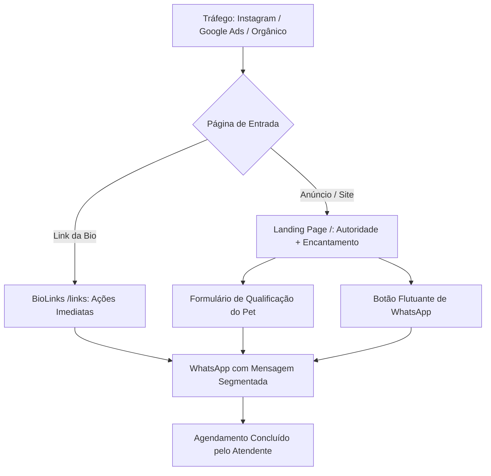

# 🐾 Pet Town — Plataforma White-Label para Pet Shops & Clínicas Veterinárias
> **Landing Page de Alta Conversão + Hub BioLinks (Instagram) + Triagem Direta para WhatsApp**  
> *Stack: Astro 5 (SSG) + React 19 Islands + Tailwind CSS v4 Oxide + Framer Motion*

---

## 📌 Sumário
1. [Visão Geral do Produto](#-1-visão-geral-do-produto)
2. [PRD de Replicação (Product Requirements Document)](#-2-prd-de-replicação)
3. [Guia Passo a Passo: Clonando para um Novo Pet Shop em 15 Minutos](#-3-passo-a-passo-de-replicação)
4. [Arquitetura de Dados (Single Source of Truth)](#-4-arquitetura-de-dados)
5. [Recursos de UX & Conversão Mobile](#-5-recursos-de-ux--conversão-mobile)
6. [Estrutura de Pastas e Componentes](#-6-estrutura-de-pastas)
7. [Instalação, Execução e Deploy](#-7-instalação-e-deploy)
8. [Configuração de Métricas & Tráfego Pago](#-8-métricas--tráfego-pago)

---

## 🚀 1. Visão Geral do Produto

Esta aplicação foi concebida como um **modelo universal replicável (White-Label)** de altíssima performance para o mercado pet: **Pet Shops, Clínicas Veterinárias, Centros de Estética Animal (Banho & Tosa), Daycares e Hospedagem Pet**.

### 🎯 Dois Canais de Conversão em Uma Única Base de Código
1. **Landing Page Institucional (`/`):**
   - **Impacto de 3 Segundos:** Hero visual com galeria elástica interativa de serviços.
   - **Pilares de Confiança (Sticky Scroll):** Autoridade médica, higiene hospitalar, cosméticos hipoalergênicos e transporte seguro.
   - **Passo a Passo em 3 Etapas:** Desmistifica o processo de agendamento e acolhimento do pet.
   - **Catálogo de Serviços:** Grid e slider mobile de 6 especialidades com botão de contato rápido.
   - **Prova Social Dinâmica:** Histórias reais de tutores com avaliação 5 estrelas.
   - **Formulário Multi-etapas de Triagem:** Coleta dados do tutor e do pet, gerando link formatado direto para o WhatsApp comercial.
   - **Botão Flutuante Circular de WhatsApp:** Fixado na lateral direita no ponto ideal de alcance do polegar (`top-[65%]`).

2. **Hub de BioLinks Mobile-First (`/links`):**
   - Projetado para o link da bio do Instagram, TikTok e campanhas de anúncios.
   - Foto real da fachada com mascote e letreiro oficial.
   - Botões de chamada para ação direta: Banho & Tosa, Consulta com Veterinário, Vacinação, Localização no Google Maps e Chave PIX.
   - Card de status em tempo real com horários de funcionamento.

---

## 📋 2. PRD de Replicação

### 2.1 Objetivo de Negócio
- **Taxa de Conversão Alvo:** Converter entre 8% e 16% dos visitantes em conversas qualificadas no WhatsApp comercial.
- **Redução de Atrito:** Zero necessidade de banco de dados, login ou senhas. Toda a interação é estática, ultrarrápida e canalizada diretamente para o mensageiro da equipe de atendimento.
- **Custo Operacional Zero:** Hospedável gratuitamente em plataformas Jamstack (Vercel, Cloudflare Pages, Netlify).

### 2.2 Persona do Tutor
- **Perfil:** Tutores de cães e gatos que consideram o pet um membro da família ("filho de quatro patas").
- **Dores Principais:** Medo de maus-tratos ou estresse no banho e tosa, insegurança quanto à higiene das toalhas, falta de horários flexíveis e demora no atendimento.
- **Gatilhos de Compra:** Fotos reais, equipe qualificada com CRMV visível, produtos dermatológicos e comunicação humanizada e carinhosa.

### 2.3 Funil de Conversão


### 2.4 Requisitos Não-Funcionais
- **Performance:** Pontuação 95+ no Google Lighthouse (Mobile e Desktop).
- **Tempo de Build:** Abaixo de 3 segundos com Astro 5 SSG.
- **SEO Técnico:** Metadados OpenGraph, Twitter Cards e Marcação estruturada Schema.org (`LocalBusiness` e `VeterinaryCare`) em JSON-LD.
- **Acessibilidade:** Conformidade WCAG 2.1 AA com suporte a `prefers-reduced-motion`.

---

## ⚡ 3. Passo a Passo de Replicação

Para clonar esta estrutura para um novo cliente (ex.: *"Pet Care São Paulo"* ou *"Clínica Vet Amigo"*), siga estas 5 etapas simples:

### Passo 1: Clonar e Instalar
```bash
git clone <URL_DO_REPOSITORIO> novo-petshop
cd novo-petshop
npm install
```

### Passo 2: Substituir as Imagens da Marca (`src/img/`)
Substitua os seguintes arquivos mantendo os mesmos nomes ou atualizando os imports:
| Arquivo | Descrição | Resolução Recomendada |
| :--- | :--- | :--- |
| `logo_pet_town.png` | Logotipo oficial da marca (PNG transparente) | 600x200 px |
| `image.png` | Fachada física da loja com letreiro / mascote | 1200x800 px |
| `banho_tosa_hero.jpg` | Foto real do banho e tosa carinhoso | 1200x800 px |
| `clinica_veterinaria.png` | Veterinário(a) atendendo pet na clínica | 1000x1000 px |
| `aline_belo_acupuntura.png` | Especialista responsável / acupuntura | 1000x1000 px |
| `pet_delivery.jpg` | Veículo ou caixa de transporte do Pet Delivery | 1000x800 px |
| `pet_shop_farmacia.jpg` | Produtos, prateleiras ou farmácia pet | 1000x800 px |

### Passo 3: Editar a Fonte da Verdade (`src/data/propertyData.js`)
Abra [`src/data/propertyData.js`](file:///home/gabriel/Documentos/Projetos/petshop/src/data/propertyData.js) e altere os campos do objeto `PETTOWN_DATA.brand`:
```javascript
export const PETTOWN_DATA = {
  brand: {
    name: "Nome do Novo Pet Shop",
    fullName: "Nome Completo • Pet Shop e Clínica Veterinária",
    slogan: "Seu slogan aqui!",
    whatsappPhone: "5511999999999", // Número comercial com DDD
    whatsapp: "https://api.whatsapp.com/send?phone=5511999999999",
    location: "Bairro, Cidade - UF",
    address: "Rua Exemplo, 123",
    fullAddress: "Rua Exemplo, 123 - Bairro, Cidade - UF, CEP",
    mapsUrl: "https://maps.google.com/?q=Seu+Pet+Shop",
    openingHours: "Seg a Sex: 08h às 18h | Sáb: 08h às 14h",
    instagram: "https://www.instagram.com/seupetshop/",
    // Mensagens pré-programadas do WhatsApp
    whatsappSimulationMessage: "Olá! Vim pelo site e gostaria de agendar um atendimento.",
    whatsappConsultancyMessage: "Olá! Gostaria de agendar consulta veterinária.",
  },
  // Altere serviços, passos e depoimentos conforme necessário...
};
```

### Passo 4: Customizar as Cores da Marca (`DESIGN.md` e `src/index.css`)
No arquivo [`src/index.css`](file:///home/gabriel/Documentos/Projetos/petshop/src/index.css), altere as variáveis CSS do tema:
```css
@theme {
  --color-primary: #F97316;       /* Cor de ação principal (botões, badges) */
  --color-primary-hover: #EA580C; /* Hover do botão */
  --color-teal: #14B8A6;          /* Cor de saúde/assepsia/clínica */
  --color-secondary: #101C30;     /* Fundo escuro e tipografia de autoridade */
}
```

### Passo 5: Testar e Publicar
```bash
# Rodar localmente
npm run dev

# Gerar build de produção estático
npm run build
```

---

## 🗄️ 4. Arquitetura de Dados

Toda a aplicação opera sob o princípio de **Zero Database & Single Source of Truth**. Não há necessidade de configurar bancos SQL/NoSQL.

O arquivo [`src/data/propertyData.js`](file:///home/gabriel/Documentos/Projetos/petshop/src/data/propertyData.js) alimenta simultaneamente:
- **Header & Footer:** Telefones, links sociais, horários e endereço.
- **Hero & Sticky Scroll:** Textos de autoridade, métricas de atendimentos e slogans.
- **Sliders de Soluções & Serviços:** Títulos, descrições, fotos e mensagens personalizadas de WhatsApp para cada serviço.
- **Prova Social:** Depoimentos, fotos dos tutores e estrelas.
- **Hub BioLinks:** Todos os links rápidos, status de expediente e botão de localização.
- **SEO Schema.org:** Metadados estruturados consumidos pelos robôs do Google.

---

## 📱 5. Recursos de UX & Conversão Mobile

Esta aplicação conta com diferenciais técnicos avançados voltados para dispositivos móveis:

### 1. Deslize Lateral Fluido com Sensibilidade Amplificada
- **Hook [`useSwipeScroll.js`](file:///home/gabriel/Documentos/Projetos/petshop/src/utils/useSwipeScroll.js):** Suporte híbrido a **touch swipe** (telas sensíveis ao toque) e **mouse drag** (emuladores e desktop).
- **Sem travamento em fotos:** Imagens possuem `user-drag: none` para impedir que o navegador confunda o arraste com download de imagem.
- **Snap Proporcional:** As cartas usam largura responsiva (`w-[84vw]` a `w-[85vw]`) permitindo espiar o próximo card (*peek effect*).
- **Controles com Setas:** Além do gesto do dedo, setas direcionais compactas (`<` e `>`) garantem acessibilidade total.

### 2. Botão Flutuante de WhatsApp Circular & Ergonômico
- Localizado na lateral direita no **meio vertical da tela (`top-[65%] right-3 sm:right-6`)**, dentro do alcance anatômico do polegar do tutor.
- Formato **circular** com radar pulsante e indicador de status online verde.
- Isolado do botão de voltar ao topo (`bottom-6 right-6`), evitando sobreposição de cliques.

---

## 📂 6. Estrutura de Pastas

```text
petshop/
├── .agents/                    # Configurações de automação e agentes
├── public/                     # Favicons, sitemap e arquivos estáticos
├── src/
│   ├── components/             # Componentes React Islands
│   │   ├── ui/                 # Componentes visuais atômicos
│   │   │   ├── LogoPetTown.jsx # Logo responsivo
│   │   │   ├── elastic-gallery.jsx # Galeria interativa do Hero
│   │   │   └── sticky-scroll-reveal.jsx # Scroll de autoridade
│   │   ├── BioLinks.jsx        # Hub de links para Instagram (/links)
│   │   ├── FloatingWhatsApp.jsx# Botão flutuante inteligente
│   │   ├── Header.jsx          # Navegação com scroll reveal
│   │   ├── Hero.jsx            # Abertura de impacto 3s
│   │   ├── QualificationForm.jsx# Formulário multi-etapas WhatsApp
│   │   ├── SocialProof.jsx     # Depoimentos e métricas
│   │   ├── Solutions.jsx       # 3 Passos + 3 Destaques visuais
│   │   ├── StructuredDataSEO.jsx# JSON-LD Schema.org para o Google
│   │   ├── TrustedLocations.jsx# Catálogo de 6 Especialidades
│   │   └── WhoWeAreStickyScroll.jsx # Pilares da clínica e estética
│   ├── data/
│   │   └── propertyData.js     # FONTE ÚNICA DA VERDADE (Dados da marca)
│   ├── img/                    # Banco de fotos oficiais da clínica
│   ├── layouts/
│   │   └── Layout.astro        # Base HTML com meta tags e scripts
│   ├── pages/
│   │   ├── index.astro         # Rota da Landing Page (/)
│   │   └── links.astro         # Rota do BioLinks (/links)
│   ├── utils/
│   │   ├── imageUtils.js       # Normalizador de imagens Astro 5
│   │   ├── scrollReveal.js     # Efeito Scroll Reveal GPU 60fps
│   │   ├── scrollUtils.js      # Scroll suave programático
│   │   └── useSwipeScroll.js   # Hook de deslize lateral com mouse/touch
│   ├── App.jsx                 # Componente orquestrador do React
│   └── index.css               # Design Tokens e Tailwind CSS v4
├── astro.config.mjs            # Configuração do Astro 5 com React
├── package.json                # Dependências e scripts
└── README.md                   # Esta documentação
```

---

## 🛠️ 7. Instalação e Deploy

### Pré-requisitos
- **Node.js:** Versão `>= 22.12.0` (recomendado Node 24).
- **Gerenciador:** `npm` ou `pnpm`.

### Scripts Disponíveis
```bash
# Iniciar servidor de desenvolvimento local (porta 5173)
npm run dev

# Compilar para produção estática (saída gerada em /dist)
npm run build

# Visualizar a versão de produção localmente
npm run preview
```

### Deploy em 1 Clique (Vercel / Cloudflare Pages / Netlify)
1. Conecte o repositório GitHub à sua conta da **Vercel** ou **Cloudflare Pages**.
2. O framework será detectado automaticamente como **Astro**.
3. Comando de build: `npm run build`.
4. Diretório de saída: `dist`.
5. Clique em **Deploy**. A página estará no ar com certificado SSL grátis e CDN global.

---

## 📊 8. Métricas & Tráfego Pago

A aplicação já vem pré-configurada para envio de eventos de conversão tanto para o **Meta Pixel (Facebook/Instagram Ads)** quanto para o **Google Analytics 4 (Google Ads)**:

### Eventos Disparados Automaticamente:
- **`generate_lead` / `Lead`:** Disparado quando o tutor conclui a triagem no formulário e é direcionado para o WhatsApp com o nome do pet e serviço de interesse.
- **`whatsapp_floating_click` / `WhatsAppFloatingClick`:** Disparado ao clicar no botão circular flutuante de WhatsApp.

Para ativar seu Pixel e GA4, basta inserir os scripts com seus IDs no arquivo [`src/layouts/Layout.astro`](file:///home/gabriel/Documentos/Projetos/petshop/src/layouts/Layout.astro).

---

<p align="center">
  <b>Pet Town White-Label System</b> • Feito por quem cuida com amor! 🐾
</p>
